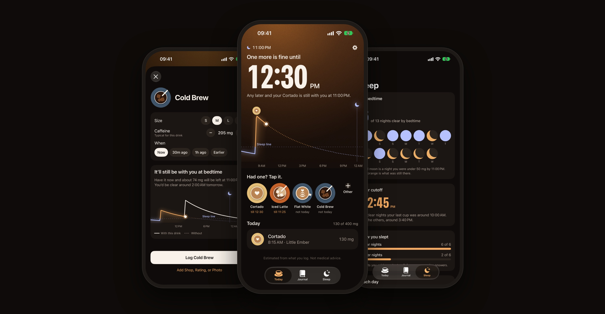

# Crema: Caffeine & Sleep

Coffee you can sleep on. Crema tells you, in one big number, when to have your last coffee so it’s gone by bedtime.

[**Download on the App Store**](https://apps.apple.com/us/app/crema-caffeine-sleep/id6819921757) · [Support](https://boyuchengz.github.io/crema/) · [Privacy policy](https://boyuchengz.github.io/crema/privacy.html)

## What it does

- One big time on the first screen: when one more coffee is still fine, and after that, when you’ll be clear for sleep.
- Tap a cup to log it and see what it changed. Hold a cup to see what it would do to tonight first.
- Your whole day as one line, from morning to bedtime. Drag along it to read any moment.
- Every drink drawn, from espresso and cold brew to matcha, energy drinks, and cola, with typical caffeine filled in. Type anything else, or photograph the cup and Crema reads it on your iPhone.
- Sleep: two weeks of nights as moons, how clear nights compare with the others, and your own cutoff time.
- Widgets for the Home Screen and Lock Screen, a Control Center button, and Siri: “Can I still have coffee?”
- A calendar of every cup, with your shops, ratings, notes, and photos. Export it as a spreadsheet.
- No account, no ads, no tracking. Everything stays on your iPhone.

Caffeine figures are estimates, not medical advice. Requires iOS 26.

## About this repository

The app’s source is private. This repository hosts the [support page](https://boyuchengz.github.io/crema/) and [privacy policy](https://boyuchengz.github.io/crema/privacy.html) served by GitHub Pages, and its [issue tracker](https://github.com/boyuchengz/crema/issues) is where bug reports and feature requests go.
